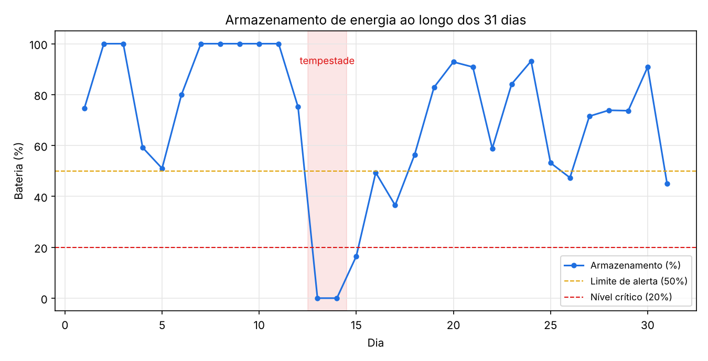
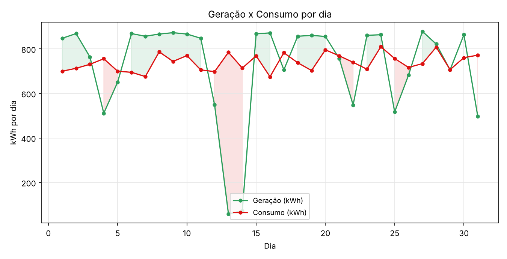
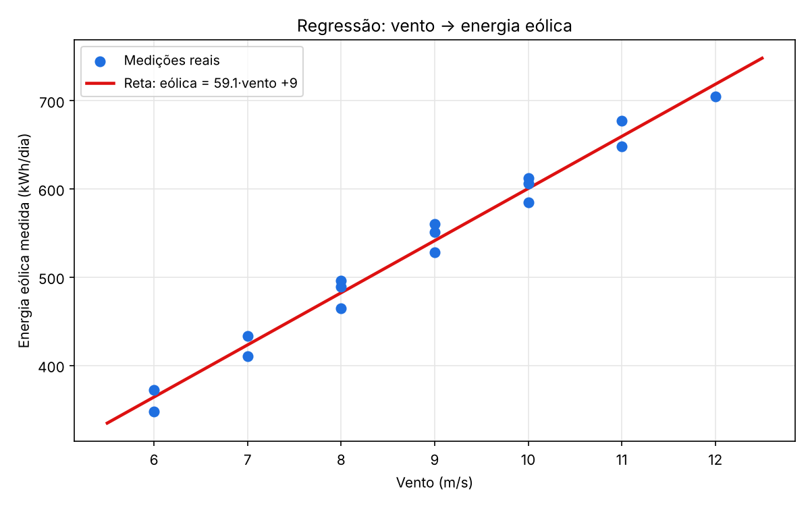

# Projeto Colônia — Missão Aurora Siger (FIAP)

Sistema integrado que simula o funcionamento inteligente de uma colônia em Marte. Continuação do projeto de pouso (MGPEB): os módulos já pousaram e agora formam a colônia, que precisa se organizar, gerar energia e tomar decisões sozinha.

Atividade integrativa da FIAP.

## O que o sistema faz

1. **Organiza os dados** da colônia em listas e estruturas hierárquicas (energia → solar / eólico / armazenamento).
2. **Toma decisões automáticas** com regras de lógica (ex.: se a energia está baixa e o consumo alto, ativa o modo economia).
3. **Prevê a geração de energia** usando regressão linear (vento → energia eólica), ajustada em medições reais.
4. **Analisa o uso de energia**, comparando geração, consumo e armazenamento.

## Exemplo de entrada e saída

O sistema recebe dados simples e devolve uma decisão clara.

**Decisão:**

```
Entrada: armazenamento = 40%, consumo = 800 kWh
Saída:   "ALERTA: ativar modo economia"  (desliga o Laboratório)
```

**Análise de energia:**

```
Entrada: geração = 40, consumo = 70
Saída:   "ALERTA: consumo maior que geração"

Entrada: geração = 80, consumo = 30
Saída:   "SUGESTÃO: armazenar energia excedente"
```

**Previsão (regressão):**

```
Entrada: vento = 11 m/s
Saída:   previsão de energia eólica ≈ 660 kWh
```

## Arquivos do repositório

| Arquivo | O que é |
|---|---|
| `colonia.py` | O programa principal. Lê os `.md` e roda os 31 dias. |
| `dados_colonia.md` | Tabela com os 31 dias: energia, consumo, geração, vento e sol. |
| `modulos_colonia.md` | Os 5 sistemas da colônia, com prioridade e fontes de energia. |
| `calculo_consumo_geracao.md` | Explica, passo a passo, como cada número é calculado. |
| `assets/` | Imagens usadas na documentação (parábola e gráficos). |

## Como rodar

Precisa só do Python 3 (nenhuma biblioteca extra para o programa principal).

```bash
git clone https://github.com/pietromaimone/PROJETO-COLONIA-FIAP.git
cd PROJETO-COLONIA-FIAP
python colonia.py
```
### Modo interativo

Para digitar um cenário (armazenamento, consumo e vento) e ver a decisão na hora:

```bash
python colonia.py -i
```

## Gráficos

**Armazenamento ao longo do mês** — mostra a bateria subindo e descendo, e o mergulho a zero na tempestade (dias 13 e 14).



**Geração x consumo** — verde quando sobra energia, vermelho quando falta.



**Regressão (vento → energia eólica)** — os pontos são medições reais; a reta vermelha é a previsão.



## Conclusão

Nos 31 dias, a colônia operou normal em 24 e precisou agir em 7. O consumo do mês (22.923 kWh) ficou bem perto da geração (22.522 kWh), ou seja, a colônia vive no limite e depende da bateria para atravessar os dias ruins.

O pior momento foi o dia 13: a tempestade desligou as turbinas, a bateria zerou e o sistema entrou em **emergência**, cortando Logística e Laboratório para proteger o suporte à vida que nunca foi desligado. O sistema de decisão deu conta, mas a margem é pequena; mais painéis ou uma bateria maior deixariam a colônia mais segura.
