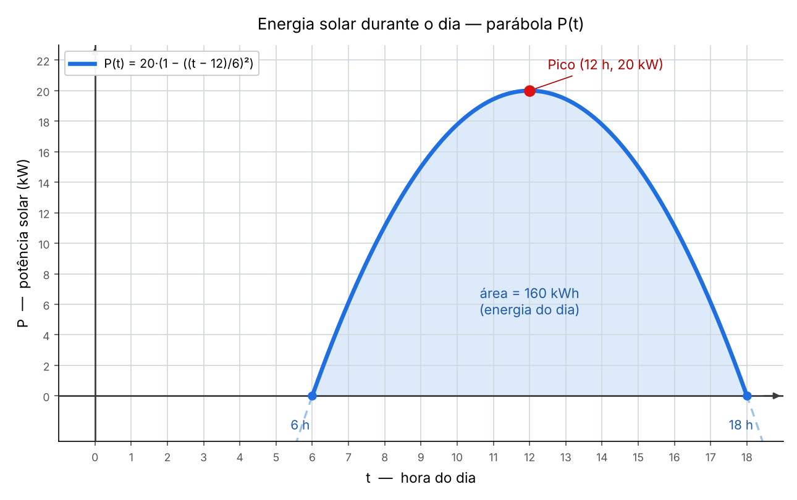

# Como se calcula o consumo e a geração de energia

Aqui a gente explica de onde vêm os números da tabela [dados_colonia.md](dados_colonia.md). Os valores foram inventados para a simulação, mas todos seguem as regras abaixo. O código que usa a tabela está no `colonia.py`.

**Unidades:**

- **kW:** potência, ou seja, quanta energia o sistema usa (ou gera) a cada hora.
- **kWh:** energia em um dia. É a potência média multiplicada pelas horas: `kWh = kW × horas`. Um sistema de 6 kW ligado o dia todo gasta `6 × 24 = 144 kWh`.

---

## 1. Consumo dos sistemas

O consumo total da colônia é a soma do consumo dos 5 sistemas da tabela [modulos_colonia.md](modulos_colonia.md):

```
consumo_total = Energia + Habitação + Suporte médico + Logística + Laboratório
```

| Sistema | Como se calcula | Faixa em kW |
|---|---|:---:|
| Energia | Fixo: a base gasta 6 kW o tempo todo | 6 |
| Habitação | 60 % do consumo de suporte à vida | 6,9 a 8,1 |
| Suporte médico | 40 % do consumo de suporte à vida (o que sobra) | 4,6 a 5,4 |
| Logística | 55 % do consumo de operações | 5,5 a 8,3 |
| Laboratório | 45 % do consumo de operações (o que sobra) | 4,5 a 6,8 |

Habitação e suporte médico formam o **suporte à vida**, e Logística e Laboratório formam as **operações**:

```
suporte_vida = Habitação + Suporte médico        (11,5 a 13,5 kW, ou seja, 276 a 324 kWh por dia)
operações    = Logística + Laboratório           (10 a 15 kW, ou seja, 240 a 360 kWh por dia)
```

O consumo de suporte à vida e o de operações variam de um dia para o outro dentro dessas faixas. Já a base de energia é sempre 144 kWh.

Quando o sistema de decisão corta carga, só Logística e Laboratório podem ser desligados. Energia, Habitação e Suporte médico nunca são cortados.

---

## 2. Geração de energia

```
produção_total = produção_solar + produção_eólica
```

### Energia solar

O sol gera energia em forma de parábola: sobe até o meio-dia e desce depois.

```
P(t) = 20 · (1 − ((t − 12) / 6)²)        em kW, para t entre 6 h e 18 h
```



*Gráfico da parábola P(t) feito no GeoGebra. O pico é ao meio-dia (12 h, 20 kW) e a curva vale 0 às 6 h e às 18 h. A área azul sob a curva, entre 6 h e 18 h, é de 160 kWh — a energia solar de um dia inteiro de sol.*

Em um dia de 12 h de sol (das 6 h às 18 h), a área sob essa curva é de **160 kWh**. Para dias com menos sol, a produção diminui na mesma proporção:

```
produção_solar = 160 × (tempo_de_sol / 12)        em kWh por dia
```

Isso equivale a cerca de **13,33 kWh por hora de sol**. É uma simplificação: na vida real um dia mais curto também muda o formato da curva.

### Energia eólica

A turbina gera mais quanto mais forte é o vento. O ajuste feito com a regressão linear é uma reta:

```
potência_eólica = 2,5 × vento        em kW (vento em m/s)
```

Duas regras limitam essa reta:

- **Teto de 30 kW:** é o máximo que a turbina entrega. Ele é atingido com vento de 12 m/s, e acima disso a produção não aumenta.
- **Tempestade:** com vento acima de 25 m/s (o mesmo limite do pouso) a turbina é desligada e a potência é 0.

```
produção_eólica = potência_eólica × 24        em kWh por dia
```

### Resumo da geração

| Vento (m/s) | Potência eólica (kW) | Produção eólica (kWh/dia) |
|:---:|:---:|:---:|
| 6 | 15,0 | 360 |
| 8 | 20,0 | 480 |
| 10 | 25,0 | 600 |
| 12 ou mais, até 25 | 30,0 | 720 |
| acima de 25 | 0 | 0 |

---

## 3. Armazenamento

A bateria guarda a sobra e entrega a falta. Sua capacidade é de 600 kWh e o dia 1 começa com 300 kWh.

```
energia_total = armazenamento do dia anterior + produção do dia
armazenamento = energia_total − consumo_total        (sempre entre 0 e 600 kWh)
```

- Se o resultado passa de 600 kWh, o excesso é perdido (a bateria está cheia).
- Se o resultado fica abaixo de 0, o armazenamento vale 0 (a colônia ficou sem reserva).

---

## 4. Exemplos da tabela

### Dia 1: vento 13,0 m/s, 9,6 h de sol

| Item | Conta | Resultado |
|---|---|:---:|
| Potência eólica | 2,5 × 13,0 = 32,5, limitado ao teto | 30 kW |
| Produção eólica | 30 × 24 | 720 kWh |
| Produção solar | 160 × 9,6 / 12 | 128 kWh |
| Produção total | 128 + 720 | 848 kWh |
| Habitação | 60 % de 289 | 173 kWh |
| Suporte médico | 289 − 173 | 116 kWh |
| Operações | 700 − 289 − 144 | 267 kWh |
| Logística | 55 % de 267 | 147 kWh |
| Laboratório | 267 − 147 | 120 kWh |
| Consumo total | 144 + 173 + 116 + 147 + 120 | 700 kWh |
| Energia total | 300 + 848 | 1148 kWh |
| Armazenamento | 1148 − 700 | 448 kWh |

### Dia 13: tempestade, vento 27,1 m/s, 4,4 h de sol

| Item | Conta | Resultado |
|---|---|:---:|
| Potência eólica | vento acima de 25 m/s, turbina desligada | 0 kW |
| Produção solar | 160 × 4,4 / 12 | 59 kWh |
| Produção total | 59 + 0 | 59 kWh |
| Consumo total | 144 + 173 + 116 + 194 + 158 | 785 kWh |
| Armazenamento | a energia disponível (509 kWh) é menor que o consumo (785 kWh) | 0 kWh |

Neste dia a colônia gera só 59 kWh e consome 785 kWh. A reserva acaba, e é aí que o sistema de decisão entra em **EMERGÊNCIA** e desliga Logística e Laboratório.

---

## O que o modelo não considera

- Cada sistema usa a mesma fração do consumo em todos os dias (60/40 e 55/45). Na vida real a divisão muda de acordo com a atividade.
- A bateria não perde energia ao guardar nem tem desgaste.
- A energia solar não considera poeira nos painéis nem nuvens.
- A potência da turbina é uma reta até o teto. Na vida real ela cresce mais devagar, com o cubo do vento.
